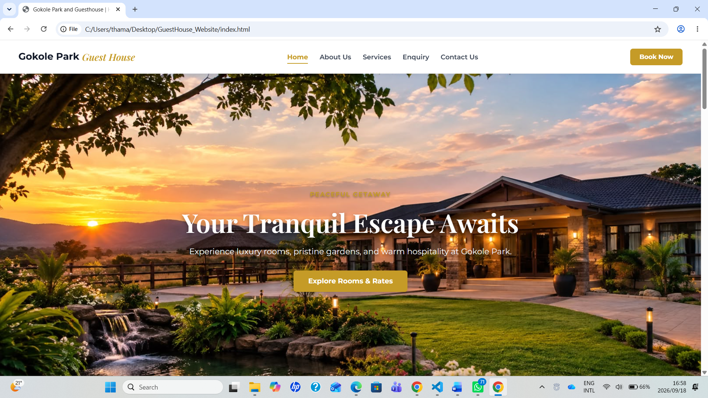
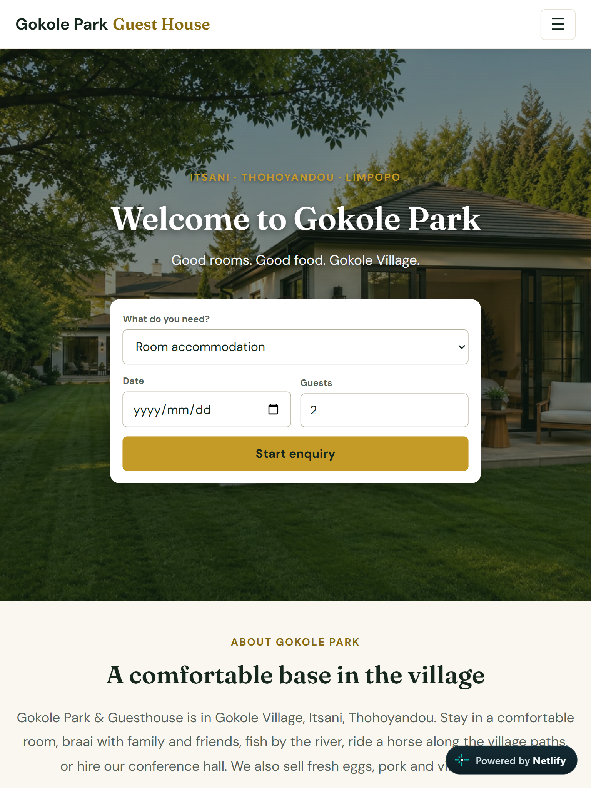
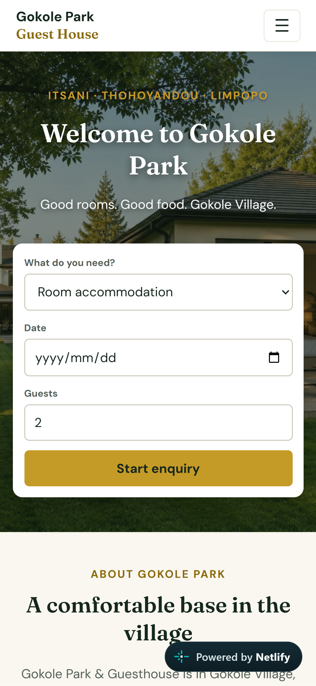

# Gokole Park & Guesthouse Website - Part 3

**Live website:** https://gokole-park-guesthouse.netlify.app
**Repository:** https://github.com/Thama-Mauba/Gokole_Park_Guesthouse

## Project Overview
A website for Gokole Park & Guesthouse in Itsani, Thohoyandou, Limpopo. Visitors can see the rooms and rates, search the services, make an enquiry, send a message, and find the guesthouse on a map. The site is built with HTML, CSS and JavaScript only (no frameworks) and is hosted on Netlify from this GitHub repository.

| Page | File | Purpose |
| :--- | :--- | :--- |
| Home | `index.html` | Welcome banner, quick booking bar, services preview, rooms and rates, reviews |
| About Us | `about.html` | Story, values and location |
| Services | `services.html` | Rooms, farm produce, conference hall and tours, with live search |
| Enquiry | `enquiry.html` | Booking and enquiry form with validation |
| Contact Us | `contact.html` | Contact details, message form and interactive map |
| Policies & Privacy | `policies.html` | Booking policies and a POPIA privacy notice |

---

## Part 3 Requirements and Where to Find Them

| Requirement | How it is done | Where |
| :--- | :--- | :--- |
| JavaScript interactive elements | Mobile hamburger menu, scroll reveal, photo lightbox, category filter buttons, slide-out notification, "Recommended" card animation | `script.js`, `style.css` |
| Dynamic content and search | Live search on the Services page. The home page booking bar and the "Book" buttons pre-fill the Enquiry form | `script.js` |
| Interactive map | Embedded map with a "Get Directions" button | `contact.html` |
| Gallery lightbox | Click or press Enter on any card photo to enlarge it. Escape closes it | `script.js` |
| SEO: title tags, meta description, keywords | A unique title, description and keywords on every page | `<head>` of each page |
| SEO: image file names and alt text | Descriptive file names (for example `garden-terrace-room-gokole-park.jpeg`) and descriptive alt text | `IMAGES/`, all pages |
| Forms: HTML controls | Text, email, phone, dropdown, date, number, radio buttons, checkbox and text area, each with a linked label | `enquiry.html`, `contact.html` |
| Forms: JavaScript validation | Checks each field on leaving it and again on submit, with a clear message under every field | `script.js` |
| Forms: AJAX submission | Sent with `fetch()` without reloading the page, with success and error messages | `script.js` |
| Deployment | Hosted on Netlify, updated automatically from the `main` branch | Netlify |
| README and changelog | This document | `README.md` |

---

## Part 3 Changelog

### A. Corrections based on Part 2 feedback

| Date | Category | Description of Changes |
| :--- | :--- | :--- |
| 2026-10-31 | **Changelog correction** | The Part 2 changelog below listed media queries and responsive images (`srcset`). The Part 2 submission did not contain them (feedback: 0/10 for media queries). They are now implemented properly, as entries 5 and 6 explain. |
| 2026-10-31 | **1. Default styles** | Rebuilt `style.css` around CSS variables (`:root`) for colours, fonts and text sizes, so the same values are used on every page. Previously colour codes were repeated throughout the file. |
| 2026-10-31 | **2. Typography** | Replaced Montserrat and Playfair Display with DM Sans (body) and Fraunces (headings). Set one type scale (`--fs-h1`, `--fs-h2`, `--fs-body`) with consistent line heights and weights. |
| 2026-10-31 | **3. Layout** | Merged three conflicting `.hero-section` rules into one. Set the hero to full screen height below the fixed navbar. Used CSS grid with `auto-fit` for card, form and panel layouts and consistent spacing everywhere. |
| 2026-10-31 | **4. Colour and decoration** | New palette: warm cream backgrounds, forest green, gold accent and a dark green-black for text. Text colours were chosen for readable contrast. Added a green footer, page banners and consistent card styling. |
| 2026-10-31 | **5. Pseudo-classes** | Added `:hover`, `:focus`, `:focus-visible`, `:active` and `:disabled` styles to navigation links, buttons, cards, filter buttons, form fields and the lightbox. |
| 2026-10-31 | **6. Media queries** | Added breakpoints at 768px (tablet) and 480px (mobile). Below 768px the navigation becomes a hamburger menu. Headings and body text get smaller through the CSS variables, grids become one column, buttons become full width, and images use `max-width: 100%` and `object-fit: cover`. |
| 2026-10-31 | **7. Missing styles and inline CSS** | Defined `.launch-card`, `.launch-tag` and `.launch-btn`, which pages used but the stylesheet never defined. Removed inline `style` attributes from all pages and moved them into `style.css`. |
| 2026-10-31 | **8. Navigation structure** | Gave every page the same header, with a `<nav>`, an active-page highlight and a menu button for small screens. |

### B. New features

| Date | Category | Description of Changes |
| :--- | :--- | :--- |
| 2026-10-31 | **JavaScript** | Replaced five separate `DOMContentLoaded` blocks with one clean `script.js` made of small functions. Each feature first checks that its elements exist, so one script works on every page. |
| 2026-10-31 | **Interactive elements** | Added the hamburger menu, scroll reveal (using `IntersectionObserver`), slide-out notification, and a "Recommended" badge with a gentle animation on the Garden Terrace Room and the Chief's Kraal tour. Animations switch off for visitors who prefer reduced motion. |
| 2026-10-31 | **Lightbox** | Rebuilt the photo lightbox so it works with the keyboard (Enter or Space to open, Escape to close) and returns focus to the photo afterwards. |
| 2026-10-31 | **Filter buttons** | The category buttons on the home page are now built from the card badges, so every category (including Dining and Adventure, which the old buttons missed) can be filtered. |
| 2026-10-31 | **Dynamic content and search** | Added a live search box on the Services page that filters cards as the visitor types and shows a message when nothing matches. Added a Rooms section to the Services page. |
| 2026-10-31 | **Quick booking bar** | The home page booking bar saves the visitor's choices (service, date, guests) for the session and pre-fills the Enquiry form. Clicking a "Book" button on any card selects the matching service. |
| 2026-10-31 | **Interactive map** | Added an embedded map of the guesthouse and a "Get Directions" button to the Contact page. |
| 2026-10-31 | **Home page redesign** | New banner with the booking bar, a services preview, rooms and rates, an "Experience Gokole" section and a closing call to action. |
| 2026-10-31 | **Content** | Rewrote the text on all pages in plainer language. Made the director's name (Mr. Mauba) and the phone number (063 143 8609) consistent on every page. |
| 2026-10-31 | **Policies and privacy** | Added `policies.html` with booking, payment, cancellation and house policies, and a privacy notice based on the Protection of Personal Information Act (POPIA). Linked from every footer and from both forms. |

### C. SEO

| Date | Category | Description of Changes |
| :--- | :--- | :--- |
| 2026-10-31 | **Titles and descriptions** | Wrote a unique `<title>` and `<meta name="description">` for every page, each describing that page's content. |
| 2026-10-31 | **Keywords** | Added `<meta name="keywords">` on every page with terms visitors might search for, such as "Gokole Park", "guesthouse Limpopo", "conference hall" and "Chief's Kraal tour". |
| 2026-10-31 | **Image names and alt text** | Renamed all 13 photos from short labels such as `room-deluxe.jpeg` to descriptive names such as `garden-terrace-room-gokole-park.jpeg`, and updated every reference. Rewrote alt text to describe each photo. Added `loading="lazy"` to photos below the first screen. |
| 2026-10-31 | **Page structure** | One `<h1>` per page, headings in order, `<main>`, `<header>`, `<nav>` and `<footer>` landmarks, and `lang="en"` on every page. |

### D. Forms

| Date | Category | Description of Changes |
| :--- | :--- | :--- |
| 2026-10-31 | **Enquiry form** | Replaced the old `mailto:` form (which only opened the visitor's email app) with a full form: name, phone, email, service dropdown, optional date and guest number, a "how should we reply" radio group, message, and a consent checkbox. |
| 2026-10-31 | **Contact form** | The Contact page had no form. Added one with name, email, optional phone and message. |
| 2026-10-31 | **Validation** | Each field is checked when the visitor leaves it, and again on submit. Messages appear under the field, for example a valid email format, a phone number of 10 to 15 digits, a date that is not in the past, and a minimum message length. The first invalid field receives focus. |
| 2026-10-31 | **AJAX submission** | The forms send with `fetch()` without reloading the page. The button is disabled while sending, and the visitor sees a success or error message. |
| 2026-10-31 | **Form handling** | Forms are handled by Netlify Forms, with a hidden honeypot field against spam. Submissions appear in the Forms section of the Netlify dashboard. Email notifications from Netlify need a paid plan, so they are not switched on. |
| 2026-10-31 | **Accessibility** | Every input has a linked `<label>`, errors use `aria-describedby` and `aria-invalid`, status messages use `role="status"`, and there is a skip link and visible keyboard focus. |

### E. Repository and deployment

| Date | Category | Description of Changes |
| :--- | :--- | :--- |
| 2026-10-31 | **GitHub** | Committed each part of the rebuild separately with a descriptive message. Removed an old, misspelled script file from the repository. |
| 2026-10-31 | **Deployment** | Connected the repository to Netlify. The site is published from the `main` branch, and each push to GitHub updates the live site. |

---

## Testing Evidence
* Tested the live site on Chrome (desktop) and on a mobile phone browser.
* Checked that all six pages load without errors, that images load, and that the navigation works on every page.
* Tested both forms with empty fields (error messages appear), with invalid values, and with valid values (success message). A test enquiry was received in the Netlify Forms dashboard.

Screenshots showing the layout at different screen sizes:

* **Desktop View:** 
* **Tablet View:** 
* **Mobile View:** 

---

## Project Structure
```
GuestHouse_Website/
├── index.html
├── about.html
├── services.html
├── enquiry.html
├── contact.html
├── policies.html
├── style.css
├── script.js
├── README.md
└── IMAGES/
```

---

## Part 2 Changelog & Iterations (previous submission)
Kept for the record of the development history.

| Date | Category | Description of Changes |
| :--- | :--- | :--- |
| 2026-09-18 | **CSS Styling** | Refactored `style.css` into a modular design using reset rules, Google Fonts, standard color schemes, and flex/grid card layouts. |
| 2026-09-18 | **Responsiveness** | Added media query breakpoints for desktop, tablet, and mobile views to ensure seamless vertical stacking on smaller screens. *(See the correction in section A above: these were completed in Part 3.)* |
| 2026-09-18 | **HTML & Images** | Updated image wrappers with relative units and responsive markup (`srcset` / `sizes`) to optimize image delivery across devices. *(See the correction in section A above.)* |
| 2026-09-18 | **JavaScript Clean-up** | Consolidated DOM listeners, added defensive safety checks for missing form inputs, and optimized scroll reveal event listeners. |
| 2026-09-18 | **Feedback Adjustments** | Corrected structural HTML tags across pages and updated navigation active state styling. |

---

## References
* CSS-Tricks. (2026). *A Complete Guide to CSS Grid*. Available at: https://css-tricks.com/snippets/css/complete-guide-grid/ (Accessed: 31 October 2026).
* MDN Web Docs. (2026). *Responsive images*. Available at: https://developer.mozilla.org/en-US/docs/Learn/HTML/Multimedia_and_embedding/Responsive_images (Accessed: 31 October 2026).
* MDN Web Docs. (2026). *Intersection Observer API*. Available at: https://developer.mozilla.org/en-US/docs/Web/API/Intersection_Observer_API (Accessed: 31 October 2026).
* MDN Web Docs. (2026). *Fetch API*. Available at: https://developer.mozilla.org/en-US/docs/Web/API/Fetch_API (Accessed: 31 October 2026).
* MDN Web Docs. (2026). *Client-side form validation*. Available at: https://developer.mozilla.org/en-US/docs/Learn/Forms/Form_validation (Accessed: 31 October 2026).
* MDN Web Docs. (2026). *Window: sessionStorage property*. Available at: https://developer.mozilla.org/en-US/docs/Web/API/Window/sessionStorage (Accessed: 31 October 2026).
* Netlify. (2026). *Forms setup*. Available at: https://docs.netlify.com/forms/setup/ (Accessed: 31 October 2026).
* Google. (2026). *Google Fonts: DM Sans and Fraunces*. Available at: https://fonts.google.com/ (Accessed: 31 October 2026).
* World Wide Web Consortium. (2026). *Web Content Accessibility Guidelines (WCAG) overview*. Available at: https://www.w3.org/WAI/standards-guidelines/wcag/ (Accessed: 31 October 2026).
* Information Regulator (South Africa). (2026). *Protection of Personal Information Act (POPIA)*. Available at: https://inforegulator.org.za/ (Accessed: 31 October 2026).
* Airbnb. (2026). *Airbnb website*. Available at: https://www.airbnb.com/ (Accessed: 31 October 2026). Used only as general design inspiration for photo-led cards and a quick booking bar. No text, images or code were copied.